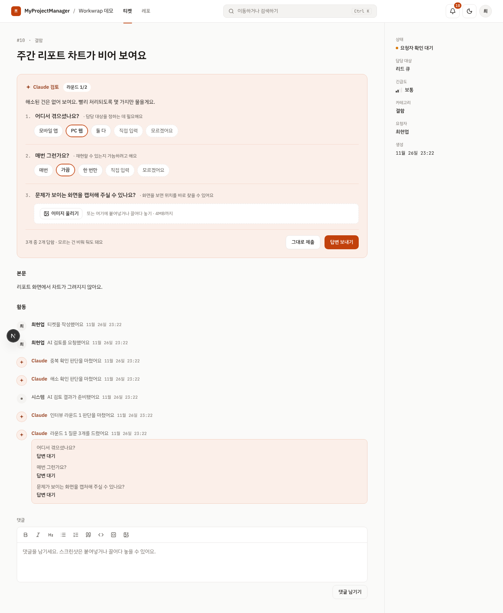
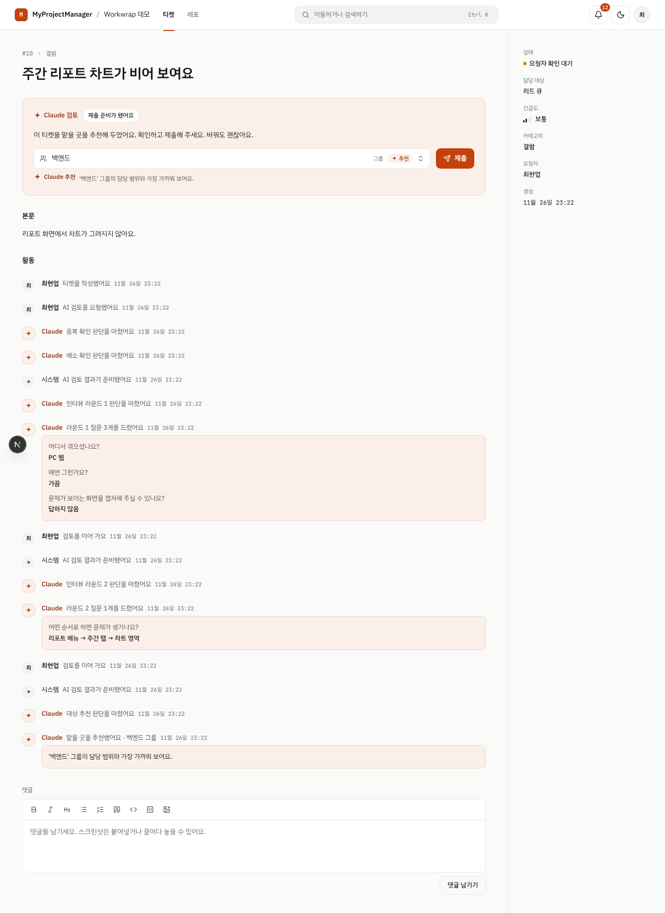
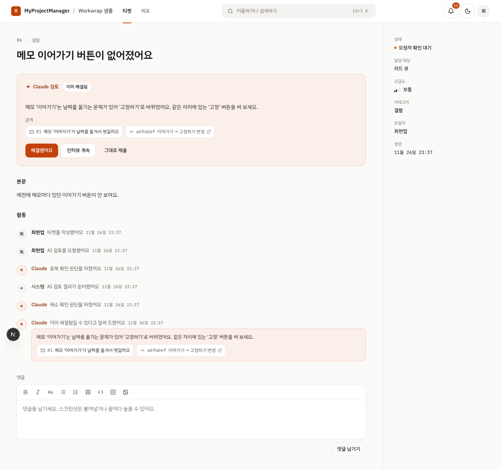
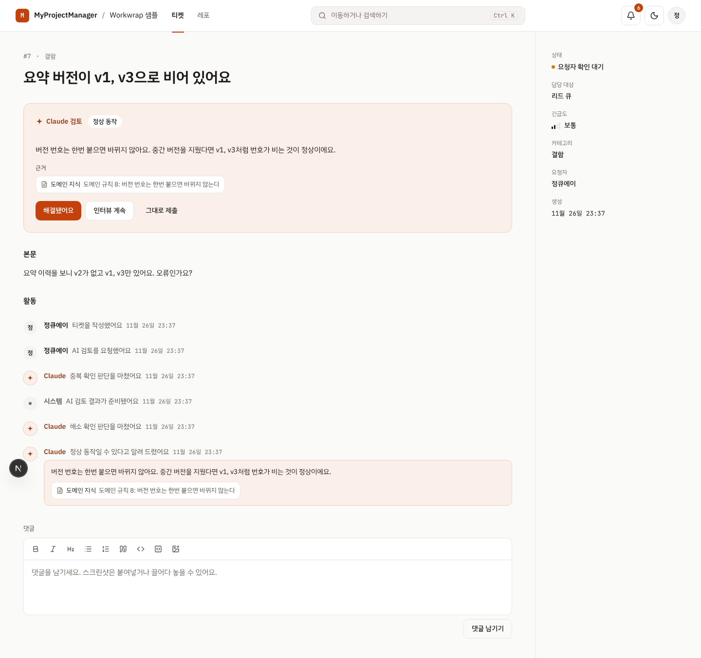
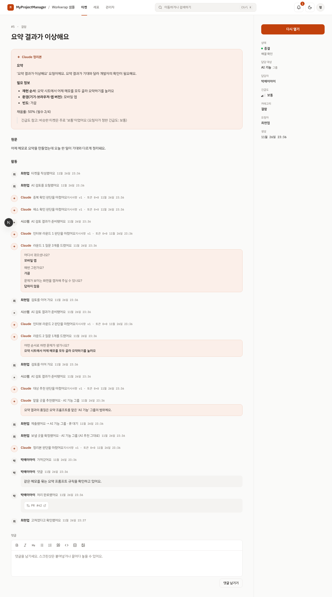
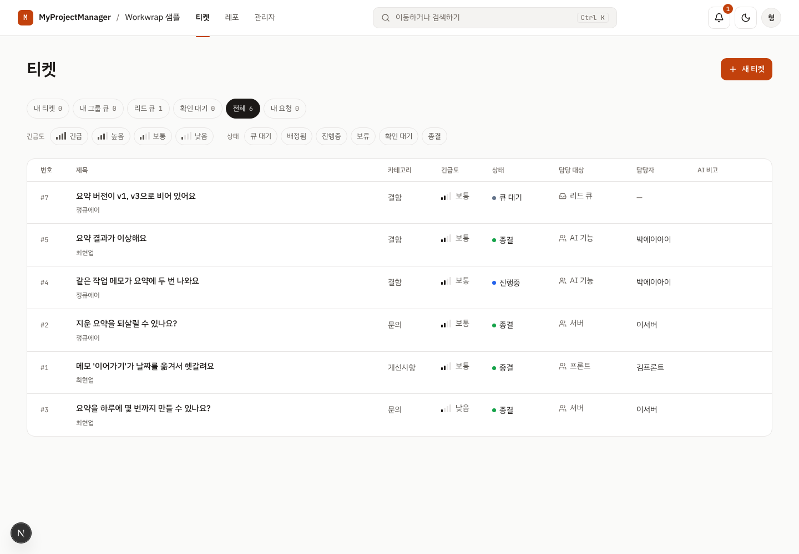
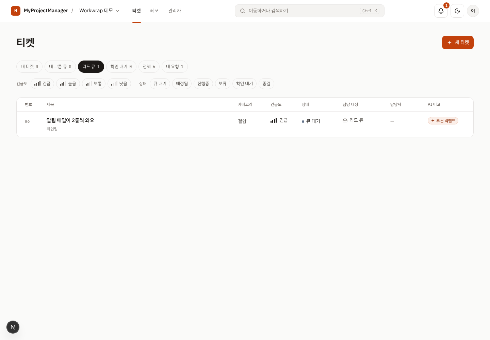
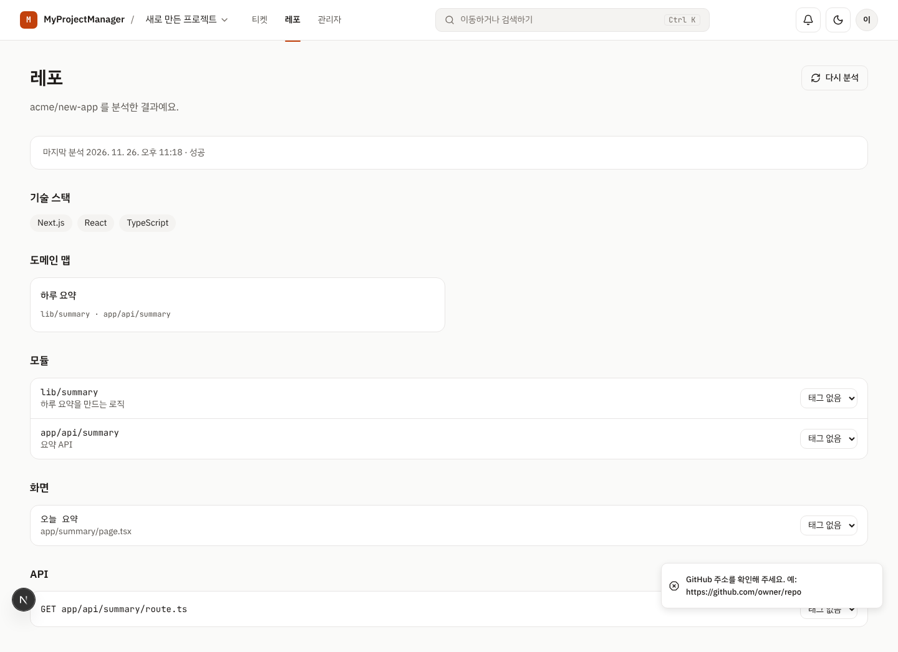

# MyProjectManager

요청자가 티켓을 쓰면 **개발자가 보기 전에 AI가 먼저 검토**하는 요청 관리 도구예요. 중복인지, 이미 해결됐거나 정상 동작인지 확인하고, 빠진 정보를 인터뷰로 채워 개발자가 읽기 좋은 정리본을 만들어요.

**AI는 제안만 하고, 결정은 사람이 해요.** AI가 티켓의 상태·대상·긴급도·종결을 바꾸는 코드 경로는 없어요. AI 제안은 실제로 있는 티켓·커밋·PR·도메인 문서를 근거로 댈 때만 보이고, 근거가 없으면 제안하지 않아요. AI는 제출을 막지도 않아요. 요청자는 언제든 "그대로 제출"할 수 있어요.

1차(이 저장소의 범위)는 요청자·개발자·리드가 쓰는 티켓 흐름, AI 검토(중복·해소·인터뷰·대상 추천·정리본), 레포 개요, 관리자 화면까지예요. 분야 에이전트, 평가 세트, 프로젝트별 AI 키 등은 이후 단계예요.

## 화면

| | |
| --- | --- |
|  |  |
| 인터뷰 질문(라운드 최대 2, 라운드당 최대 3문항) | 제출 준비: AI가 추천한 그룹을 확인하고 바꿀 수 있어요 |
|  |  |
| 해소 카드(이미 해결됨): 종결 티켓·커밋을 근거로 보여줘요 | 해소 카드(정상 동작): 도메인 규칙 문서를 근거로 보여줘요 |
|  |  |
| 상세 타임라인: 검토 턴, AI 판단(✦ Claude), 배정, 댓글, 종결 | 시연 프로젝트의 티켓 목록 |
|  |  |
| 리드 큐 | 레포 개요와 그룹 태그 |

## 구조

- **스택**: Next.js 16(App Router), React 19, TypeScript, Drizzle ORM(Postgres, 운영은 Neon), Better Auth(조직 = 프로젝트, 역할 requester·developer·lead), Vercel AI SDK, Tiptap 마크다운 편집기, Playwright·Vitest.
- **DB 작업 큐**: AI 단계는 요청 안에서 돌리지 않고 `jobs` 테이블에 넣어요(`FOR UPDATE SKIP LOCKED`로 집고, 제한 시간·재시도·오래된 작업 회수). 응답이 끝난 뒤 한 번 돌리고, 못 미친 부분은 크론(`/api/cron/jobs`)이 처리해요.
- **에이전트**: 해소 검사(소형 모델), 리드(인터뷰), 대상 추천, 정리자, 레포 분석(중형). 지시사항은 프로젝트별로 버전을 쌓고, 모든 판단은 `ai_judgments`에 지시사항 버전·근거·토큰 수와 함께 남아요.
- **근거 정규화**: 모델이 돌려준 근거(`ticket:`, `commit:`, `pr:`, `doc:`)는 이 프로젝트에 실제로 있는지 코드가 다시 확인해요. 없는 것은 지우고, 남은 근거가 없으면 카드를 띄우지 않아요. 약한 근거(커밋·PR뿐)는 "추정"으로 표시해요.
- **제공자 이식 스키마**: 구조화 출력 스키마는 Anthropic·OpenAI·Google strict 모드에서 모두 통과하는 모양만 써요(열린 키 객체 금지 등, `tests/ai/schema-portability.test.ts`). 모델은 `getModel` 한 곳, 파일은 `BlobStore`, 레포는 `RepoSource`만 거쳐요.
- **상태 기계**: 티켓의 모든 변경은 `performAction` 한 곳을 지나고, 같은 트랜잭션에서 `ticket_events`를 남겨요. 낙관적 잠금(`version`)으로 두 사람이 동시에 가져가면 한 명만 성공해요.

## 로컬에서 실행

필요한 것: Node.js, pnpm, Postgres.

```bash
pnpm install
cp .env.example .env.local   # 아래 환경 변수를 채운다
pnpm db:migrate              # 마이그레이션 적용(DATABASE_URL)
pnpm seed:demo               # 시연 데이터(몇 번 실행해도 같은 결과)
pnpm dev
```

| 환경 변수 | 설명 |
| --- | --- |
| `DATABASE_URL` | Postgres 연결 문자열. localhost는 `pg`, 그 밖에는 Neon WebSocket 드라이버를 써요 |
| `BETTER_AUTH_SECRET`, `BETTER_AUTH_URL` | 인증 비밀값과 앱 주소(예: `http://localhost:3000`) |
| `APP_ENCRYPTION_KEY` | GitHub 토큰 암호화 키(base64, 32바이트) |
| `CRON_SECRET` | `/api/cron/jobs` 호출 인증(`Authorization: Bearer`) |
| `ANTHROPIC_API_KEY`, `OPENAI_API_KEY`, `GOOGLE_GENERATIVE_AI_API_KEY` | 쓰는 제공자의 키(1차 AI는 시연 프로젝트에서만 서버 키로 돌아요) |
| `BLOB_READ_WRITE_TOKEN` 또는 `BLOB_STORE_ID` | 이미지 업로드(비공개 Blob). Vercel에서는 OIDC(`BLOB_STORE_ID`) |
| `LANGFUSE_PUBLIC_KEY`, `LANGFUSE_SECRET_KEY`, `LANGFUSE_BASEURL` | 선택. 없으면 추적만 꺼져요 |
| `MPM_FAKE_AI=1` | 실제 모델 대신 결정적인 가짜 응답과 고정 레포 정보를 써요(네트워크·키 불필요) |
| `MPM_FAKE_BLOB=1` | 업로드를 메모리 저장소로 대체해요 |

키 없이 둘러보려면 `MPM_FAKE_AI=1 MPM_FAKE_BLOB=1`로 실행하세요.

### 시연 데이터와 계정

> **주의**
> - 시연 계정의 비밀번호(`demo1234`)는 공개돼 있고, 그중 하나는 lead예요. 외부에서 접근할 수 있는 배포에는 넣지 마세요.
> - 시연 프로젝트는 그 배포의 서버 AI 키(`ANTHROPIC_API_KEY` 등)로 실제 모델을 호출하므로 비용이 들어요.
> - 다시 실행하면 시드 그룹·도메인 지식·멤버가 시드 값으로 되돌아가요(직접 고친 내용이 사라져요).
> - 대상이 로컬 DB가 아니면 `SEED_DEMO_CONFIRM=1`을 붙이지 않는 한 시드가 멈춰요. 실행할 때 대상 호스트를 먼저 출력해요.

`pnpm seed:demo`는 "Workwrap 샘플" 프로젝트(샘플 레포 `PorkbellyCode/MyProjectManager-sample-repo`), 그룹 4개(프론트·서버·AI 기능·외주개발사), 인수인계 문서에서 나눈 도메인 지식 6개, 실제 이벤트가 있는 과거 티켓 4개를 만들어요. `MPM_FAKE_AI=1`이면 레포 분석도 바로 돌려요. 비밀번호는 모두 `demo1234`예요.

| 이메일 | 이름 | 역할(그룹) |
| --- | --- | --- |
| `lead@demo.dev` | 형준 | lead |
| `fe@demo.dev` | 김프론트 | developer(프론트) |
| `be@demo.dev` | 이서버 | developer(서버) |
| `ai@demo.dev` | 박에이아이 | developer(AI 기능) |
| `vendor@demo.dev` | 외주개발사 담당 | developer(외주개발사) |
| `req@demo.dev` | 최현업 | requester |
| `qa@demo.dev` | 정큐에이 | requester |

가짜 AI로 해 볼 만한 시나리오: req로 "요약 결과가 이상해요"를 쓰면 질문 2라운드 뒤 "AI 기능" 그룹이 추천돼요. "메모 이어가기 버튼이 없어졌어요"는 이미 해결됨 카드(종결 티켓·커밋 `a69abef`), "요약 버전이 v1, v3으로 비어 있어요"는 정상 동작 카드(도메인 규칙 8)가 떠요.

## 테스트

```bash
pnpm test        # Vitest (PGlite 인메모리 DB)
pnpm e2e         # Playwright: 새 DB를 만들고 서비스·시드로 채운 뒤 전체 화면 흐름
pnpm typecheck && pnpm lint
```

E2E는 로컬 Postgres(`postgres://postgres@127.0.0.1:54329/postgres`, `E2E_PG_ADMIN_URL`로 바꿈)가 필요하고 시스템 Chrome을 써요. `e2e/demo-flow.spec.ts`는 시드 프로젝트에서 요청 → 검토 → 질문 → 제출 → 처리 → 확인 → 종결, 해소 카드 두 가지, 리드 큐까지 전체 시연 흐름을 확인해요.

## 배포

- Vercel + Neon. `pnpm vercel-build`는 프로덕션 배포(`VERCEL_ENV=production`)에서만 `drizzle-kit migrate`를 돌린 뒤 빌드해요. 프리뷰는 DB를 건드리지 않아요.
- 작업 큐 크론: `vercel.json`은 `/api/cron/jobs`를 하루 한 번 호출해요(Hobby 플랜 제한). 그 사이에는 요청 뒤 한 번 돌리는 것으로 충분하지만, 더 자주 돌리려면 외부 스케줄러에서 `Authorization: Bearer $CRON_SECRET`으로 GET 호출하세요.
- 파일은 비공개 Blob에 두고 앱 경로(`/api/files/...`)로 권한을 확인한 뒤 내려줘요. Vercel에서는 OIDC로 연결해요.
- 업로드는 서버리스 본문 한도(4.5MB) 때문에 4MB로 제한해요.
- 시연 데이터를 원격 DB에 넣으려면 위 주의사항을 확인한 뒤 `SEED_DEMO_CONFIRM=1 pnpm seed:demo`를 실행하세요.
- 배포 후 확인: `pnpm check:deploy https://<배포 주소>`(또는 `DEPLOY_URL=… pnpm check:deploy`). 배포된 스타일시트에 디자인 토큰(`--surface`, `.bg-surface`)과 편집기 스타일(`.mpm-prose`)이 있고 create-next-app 기본값(`--font-geist-sans`)이 없는지 봐요. 실패하면 빌드 캐시 없이 다시 배포하세요.

## 개발 과정

이 앱은 Claude Code의 서브에이전트 주도 개발로 만들었어요. 계획을 작업 단위로 나눠 각 작업을 서브에이전트가 구현하고, 다른 에이전트가 독립적으로 리뷰하고, 지적된 수정도 다시 리뷰했어요. 리뷰가 실제로 잡은 문제의 예:

- 검토 중 LLM이 실패하거나 시간 초과되면 티켓이 `ai_reviewing`에 갇히는 경로
- Anthropic·OpenAI·Google 중 한 곳에서 거부되는, 제공자 호환이 안 되는 구조화 출력 스키마
- 강조색 값이 스타일에 그대로 들어가는 저장형 XSS 지점
- Vercel의 4.5MB 요청 본문 한도를 넘는 이미지 업로드
- 서비스의 규칙을 우회하는 Better Auth 조직 엔드포인트(HTTP로 멤버·역할을 바꿀 수 있었음)

모든 작업이 한 번에 맞은 것은 아니에요. 위 항목은 구현 직후에는 그대로 들어 있었고, 리뷰와 재리뷰를 거쳐 고쳤어요.
